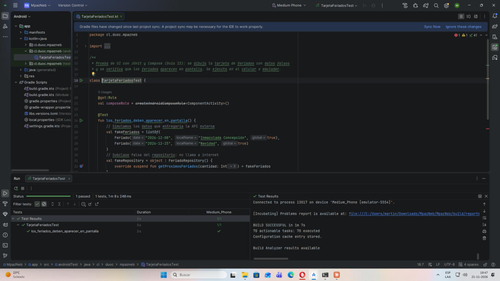
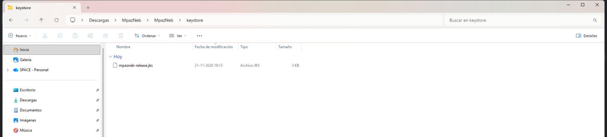
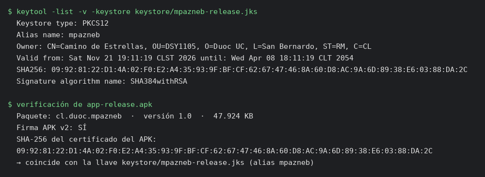
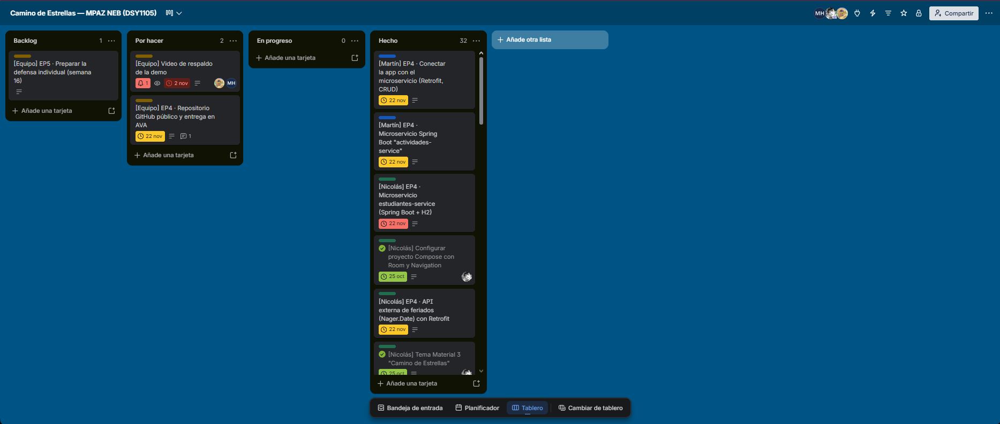

# Camino de Estrellas — MPAZ NEB

## 1. Nombre del proyecto

**Camino de Estrellas** (caso MPAZ NEB, Escuela Escritora Marcela Paz) — DSY1105 Desarrollo de Aplicaciones Móviles, Duoc UC.

App Android en Kotlin + Jetpack Compose (Material 3) que ayuda a practicar **Lectura y Matemática de 1.º a 4.º básico**: cada estudiante entra con su avatar y su PIN, ve las actividades disponibles de su curso como un camino que se desbloquea de lo más fácil a lo más difícil, gana estrellas de práctica e insignias, y su avance queda guardado para que la docente y la asistente orienten el refuerzo. Las actividades y preguntas se guardan en el microservicio **`actividades-service`** y los estudiantes y sus resultados en el microservicio **`estudiantes-service`** (ambos propios, en Spring Boot).

- **Repositorio:** https://github.com/martin69-night/MpazNeb
- **Tablero Trello:** https://trello.com/b/UmqMTjIQ/camino-de-estrellas-mpaz-neb-dsy1105

## 2. Integrantes

- Nicolás Ortega
- Martín Vásquez
- Justin Galleguillos

## 3. Funcionalidades

### Qué hace cada perfil

| Perfil | Qué puede hacer |
|---|---|
| **Estudiante** | Entra eligiendo su curso, tocando su avatar y escribiendo su PIN de 4 números en un teclado grande (no necesita leer ni escribir). Llega a **Mis asignaturas**: arriba ve a su profesor/a con su foto y abajo Lectura y Matemática con su avance. Al tocar una asignatura ve **todas sus actividades disponibles en orden**; se abren una a una al terminar la anterior. Gana de 1 a 3 estrellas (de práctica, no son nota) e insignias. |
| **Docente / UTP** | Crea y edita actividades y preguntas, fotografía el material, deja una actividad disponible o la desactiva, registra estudiantes, ve su progreso y sube su foto de perfil (cámara o galería), que ven los estudiantes de su curso. |
| **Asistente de aula** | Registra estudiantes (con la foto del dibujo de su personaje), ve el progreso y las respuestas de cada uno, escribe observaciones y configura la escuela (GPS). No puede editar actividades ni respuestas correctas. |

El estudiante solo ve las actividades **de su curso** que la docente dejó **disponibles**, así que el nivel lo decide siempre un adulto.

### Integración con el backend (EP4)

| Funcionalidad | Cómo funciona |
|---|---|
| **CRUD de actividades y preguntas (actividades-service)** | En el panel de la docente: crear y editar actividades (POST / PUT), dejarlas disponibles o desactivarlas (PATCH), eliminar borradores (DELETE), y crear, editar y eliminar preguntas. Cada operación se envía al microservicio con **Retrofit**; si responde bien, el resultado se guarda en Room y la pantalla se actualiza sola. |
| **CRUD de estudiantes (estudiantes-service)** | Registrar estudiante (POST), ver la lista sincronizada (GET), guardar la observación pedagógica (PATCH) y eliminar al estudiante con su historial (DELETE, ícono de basurero en Progreso). Cada intento terminado por un estudiante se envía al microservicio (POST de resultados); si no hay red, queda guardado en el teléfono. |
| **Sincronización** | Al abrir el panel se descargan las actividades, preguntas y estudiantes de los microservicios (GET) y se actualiza Room. Un aviso indica "Conectado al microservicio" o "Sin conexión" (en ese caso se muestran los datos guardados en el teléfono). |
| **Errores claros** | Si el microservicio está apagado o rechaza un dato (por ejemplo, nombre repetido), la app muestra el mensaje y no se cae. |
| **API externa** | Tarjeta "Próximos feriados en Chile" en el panel de actividades, consumida con Retrofit desde la API pública **Nager.Date**. Ayuda a la docente a planificar. No se guarda en Room ni en el microservicio. |
| **Persistencia local** | Room / SQLite con 7 tablas: el camino del estudiante funciona aunque no haya red. |

### Recursos nativos

| Recurso | Para qué se usa | Permiso |
|---|---|---|
| **Cámara** | El estudiante dibuja su personaje en papel y se le saca una foto: ese dibujo es su avatar, así nunca se fotografía la cara de un niño. La docente puede fotografiar el material de una actividad y tomarse su foto de perfil (también puede elegirla de la galería). | `CAMERA` (en tiempo de ejecución); la galería no necesita permiso |
| **GPS** | Se guarda la ubicación de la escuela. Con la opción "Solo practicar dentro de la escuela", el camino del estudiante se abre únicamente si el GPS confirma que está dentro del radio (condición del caso: uso dentro del establecimiento). | `ACCESS_FINE_LOCATION` / `ACCESS_COARSE_LOCATION` |
| **Notificaciones** | Avisan cuando un estudiante termina una actividad y cuántas estrellas ganó. | `POST_NOTIFICATIONS` (Android 13+) |

## 4. Endpoints utilizados

### Microservicio propio — `actividades-service` (Spring Boot + JPA + H2)

Base URL desde la app: `http://localhost:8080/` (con `adb reverse`, ver pasos para ejecutar).

| Método | Endpoint | Qué hace | Uso en la app |
|---|---|---|---|
| GET | `/api/actividades` | Lista todas las actividades | Sincronizar el panel |
| GET | `/api/actividades/{id}` | Una actividad | — (pruebas en navegador) |
| POST | `/api/actividades` | Crea una actividad (queda en BORRADOR) | Formulario "Nueva actividad" |
| PUT | `/api/actividades/{id}` | Actualiza los datos de una actividad | Formulario "Editar actividad" |
| PATCH | `/api/actividades/{id}/estado` | Cambia el estado `{"estado":"DISPONIBLE"}` | Botones "Dejar disponible" / "Desactivar" |
| DELETE | `/api/actividades/{id}` | Elimina una actividad en borrador y sus preguntas | Botón "Eliminar actividad" |
| GET | `/api/actividades/{id}/preguntas` | Preguntas de una actividad | — (pruebas en navegador) |
| POST | `/api/actividades/{id}/preguntas` | Agrega una pregunta | Formulario "Agregar pregunta" |
| GET | `/api/preguntas` | Lista todas las preguntas | Sincronizar el panel |
| PUT | `/api/preguntas/{id}` | Actualiza una pregunta | Formulario "Editar pregunta" |
| DELETE | `/api/preguntas/{id}` | Elimina una pregunta | Ícono de basurero |

Reglas de negocio validadas en el microservicio: nombre de actividad único (409), una actividad sin preguntas no puede quedar disponible (409), solo se eliminan borradores (409), campos obligatorios y rangos con Bean Validation (400), id inexistente (404).

Base de datos: H2 en archivo (`microservicios/actividades-service/data/`). Consola web: `http://localhost:8080/h2-console` (JDBC URL `jdbc:h2:file:./data/actividadesdb`, usuario `sa`, sin contraseña).

### Microservicio propio — `estudiantes-service` (Spring Boot + JPA + H2)

Base URL desde la app: `http://localhost:8081/`.

| Método | Endpoint | Qué hace | Uso en la app |
|---|---|---|---|
| GET | `/api/estudiantes` | Lista todos los estudiantes | Sincronizar la pestaña Estudiantes |
| GET | `/api/estudiantes/{id}` | Un estudiante | — (pruebas en navegador) |
| POST | `/api/estudiantes` | Registra un estudiante (PIN como hash) | Formulario "Nuevo estudiante" |
| PATCH | `/api/estudiantes/{id}/observacion` | Guarda la observación `{"observacion":"..."}` | Progreso → "Guardar observación" |
| DELETE | `/api/estudiantes/{id}` | Elimina al estudiante y su historial | Progreso → ícono de basurero |
| GET | `/api/estudiantes/{id}/resultados` | Historial de intentos del estudiante | — (reportes) |
| POST | `/api/estudiantes/{id}/resultados` | Registra un intento terminado | Al terminar una actividad |
| GET | `/api/resultados` | Todos los intentos | — (reportes) |

Reglas: apodo único por curso (409), aciertos ≤ total (409), validaciones de campos (400), id inexistente (404). Consola H2: `http://localhost:8081/h2-console` (JDBC URL `jdbc:h2:file:./data/estudiantesdb`).

### API externa — Nager.Date

| Método | Endpoint | Qué devuelve |
|---|---|---|
| GET | `https://date.nager.at/api/v3/NextPublicHolidays/CL` | Feriados de Chile de los próximos 365 días (se muestran los 3 próximos nacionales) |

### Arquitectura (MVVM)

```
Screen (Compose) → ViewModel (StateFlow) → Repository ─┬→ ApiService / EstudiantesApiService (Retrofit) → actividades-service (8080) / estudiantes-service (8081) → H2
                                                       └→ DAO → Room (SQLite)
TarjetaFeriados → FeriadosViewModel → FeriadoRepository → FeriadosApiService (Retrofit) → API Nager.Date
```

```
app/src/main/java/cl/duoc/mpazneb/
├── data/
│   ├── local/          Room: entity/, dao/, AppDatabase, DatosIniciales
│   ├── model/          Feriado (modelo de la API externa)
│   ├── remote/         ApiService + EstudiantesApiService + RetrofitInstance (microservicios), FeriadosApiService + FeriadosRetrofitInstance (API externa), Errores
│   └── repository/     ActividadRepository y EstudianteRepository (microservicios + Room), FeriadoRepository (API externa), Usuario/Escuela (Room)
├── model/              Enums y lógica pura (camino, logros)
├── validacion/         Validaciones de formularios
├── nativo/             Cámara, GPS, notificaciones
├── viewmodel/          Un ViewModel por pantalla
└── ui/                 components/, navigation/, screen/, theme/

microservicios/actividades-service/src/main/java/cl/duoc/mpazneb/actividades/
├── controller/         ActividadController, PreguntaController, ManejadorErrores
├── service/            ActividadService (reglas de negocio)
├── repository/         ActividadRepository, PreguntaRepository (JPA)
├── model/              Actividad, Pregunta (entidades) y enums
├── dto/                CambioEstadoRequest, ErrorResponse
├── exception/          RecursoNoEncontrado, ReglaNegocio
└── config/             DatosIniciales (12 actividades y 35 preguntas de prueba)

microservicios/estudiantes-service/src/main/java/cl/duoc/mpazneb/estudiantes/
├── controller/         EstudianteController, ResultadoController, ManejadorErrores
├── service/            EstudianteService (reglas de negocio)
├── repository/         EstudianteRepository, ResultadoRepository (JPA)
├── model/              Estudiante, Resultado (entidades)
├── dto/                ObservacionRequest, ErrorResponse
├── exception/          RecursoNoEncontrado, ReglaNegocio
└── config/             DatosIniciales (6 estudiantes ficticios, PIN 1234)
```

## 5. Pasos para ejecutar

### 5.1 Microservicios

1. Conectar el celular por USB (depuración USB activada) o abrir el emulador.
2. Doble clic en `microservicios/iniciar-microservicios.bat`.
   - Usa el Java que trae Android Studio, ejecuta `adb reverse` de los puertos 8080 y 8081 (el celular ve los puertos del PC) y abre una ventana por microservicio con `gradlew bootRun`.
   - Si el celular o emulador se conecta después, ejecutar `microservicios/conectar-celular.bat` (solo hace `adb reverse`).
   - También se puede abrir cada carpeta en Visual Studio Code / IntelliJ y ejecutar `ActividadesServiceApplication` y `EstudiantesServiceApplication`.
3. Comprobar en el navegador: `http://localhost:8080/api/actividades` (12 actividades) y `http://localhost:8081/api/estudiantes` (6 estudiantes).

### 5.2 App móvil

1. Abrir la carpeta raíz del repositorio en **Android Studio** y esperar el *Gradle Sync*.
2. Seleccionar la configuración **app** y el dispositivo, y presionar ▶ Run.
3. Ingresar como docente (`docente.demo` / `Mpaz2026`): la pestaña Actividades debe mostrar "🟢 Conectado al microservicio".

**Datos de prueba (ficticios):**
- Docentes: `docente.demo` (1.º, Profesora Carmen), `docente2.demo` (2.º), `docente3.demo` (3.º) y `docente4.demo` (4.º), clave `Mpaz2026`
- Asistente: `asistente.demo` / `Mpaz2026`
- Estudiantes: Luna y Benja (1.º), Cami y Tomi (2.º), Pía (3.º) y Nico (4.º), todos con PIN `1234`

### 5.3 Pruebas unitarias y cobertura

- Configuración **Pruebas + cobertura** → ▶ Run (o `gradlew :app:reporteCobertura`).
- Pruebas con **Kotest (StringSpec) + MockK + kotlinx-coroutines-test** sobre JUnit 5, en `app/src/test/java`: repositorios (actividades, estudiantes, feriados, usuarios y escuela, con DAO y ApiService mockeados), ViewModel de feriados, errores, validaciones y lógica del camino.
- Reporte de cobertura (JaCoCo): `app/build/reports/jacoco/reporteCobertura/html/index.html` — **95,9 % de las líneas de la lógica**.
- Prueba de UI con Compose: `app/src/androidTest/java/.../TarjetaFeriadosTest.kt` (se ejecuta con el celular o el emulador: botón ▶ junto a la clase).



### 5.4 APK firmado

- Configuración **APK firmado (release)** → ▶ Run (o `gradlew :app:assembleRelease`).
- La firma está configurada en `app/build.gradle.kts` (`signingConfigs.release`) con la llave `keystore/mpazneb-release.jks` (alias `mpazneb`).
- Resultado: `app/build/outputs/apk/release/app-release.apk` (copia en `apk/app-release.apk`).

## 6. APK firmado y llave (.jks)

**APK firmado** (`apk/app-release.apk`):


**Llave** (`keystore/mpazneb-release.jks`):



**Verificación de la firma**: el APK está firmado (esquema v2) con el certificado de la llave `mpazneb-release.jks`:



## 7. Planificación y trabajo en equipo

- **Trello:** https://trello.com/b/UmqMTjIQ/camino-de-estrellas-mpaz-neb-dsy1105 — una tarjeta por tarea con su responsable (etiqueta de color por integrante), fecha y el commit asociado. Listas: Backlog · Por hacer · En progreso · Hecho.
- **GitHub:** https://github.com/martin69-night/MpazNeb — Martín y Nicolás suben sus partes con sus propios commits; las funcionalidades nuevas entran por ramas `feature/...` y pull requests a `main`.

| Integrante | Responsable de (EP4) |
|---|---|
| Martín Vásquez | Microservicio `actividades-service`, conexión de la app con los microservicios (Retrofit, CRUD), scripts para iniciar los microservicios, APK firmado |
| Nicolás Ortega | Microservicio `estudiantes-service`, API externa de feriados, pruebas unitarias y de UI, README |



---

> Todos los datos son ficticios: apodos, sin RUT, sin diagnósticos ni calificaciones. Los estudiantes nunca tienen foto de su cara: su avatar es la foto de un dibujo. Solo los adultos pueden subir una foto real de sí mismos.
